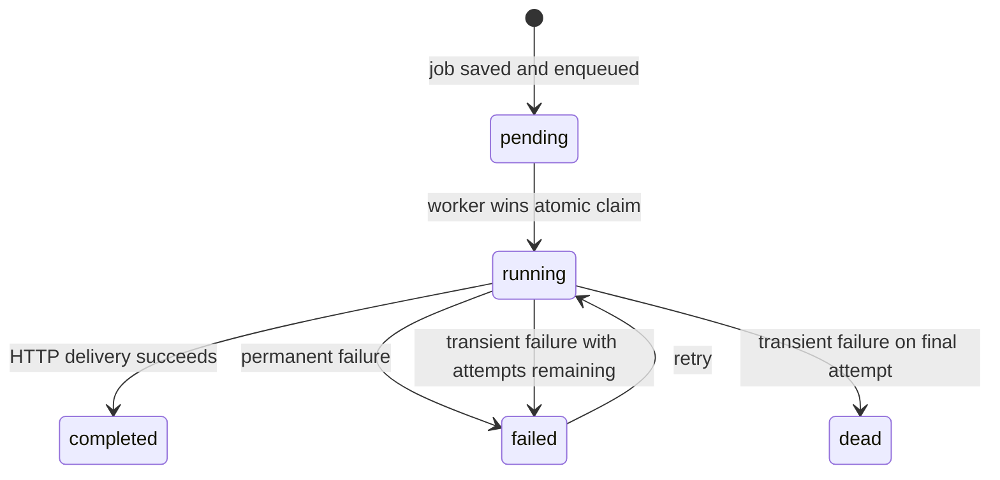
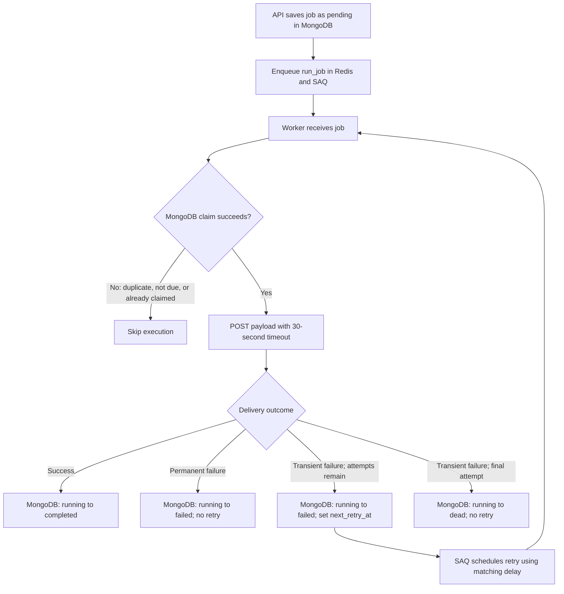

# Job lifecycle and retries

This document describes the current implementation of job state, retry
decisions, duplicate protection, and the failure-recovery trade-offs.

## Sources of truth

- **MongoDB** is authoritative for the application-visible job status,
  completed attempt count, and `next_retry_at`.
- **Redis/SAQ** stores and dispatches queued work, tracks SAQ attempts, and
  schedules a failed execution to run again after its retry delay.
- The two stores are not updated in a distributed transaction. The worker
  writes retry state to MongoDB and configures SAQ's retry delay before
  re-raising the delivery error for SAQ to process.

The same calculated delay is written as an absolute UTC `next_retry_at` in
MongoDB and as seconds in `saq_job.retry_delay`. MongoDB is checked again when
the execution is claimed; a queue delivery alone is not sufficient to run an
early retry.

## State machine

| Status | Meaning | Normal next step |
| --- | --- | --- |
| `pending` | Job was created and is awaiting its first execution. | Worker claims it and sets `running`. |
| `running` | A worker claimed the job and is delivering it. | Set `completed`, `failed`, or `dead` based on the outcome. |
| `failed` | A delivery failed. If `next_retry_at` is set, it is waiting for a retry; if null, no retry is scheduled. | A due retry can be claimed; a permanent failure remains terminal in normal processing. |
| `completed` | Delivery succeeded. | Terminal. |
| `dead` | A transient failure occurred at the attempt limit. | Terminal. The job remains in MongoDB, but there is no separate dead-letter queue or re-drive workflow. |

The FSM is encoded in `JOB_STATUS_TRANSITIONS`. `transition_job()` validates
that a transition is allowed and then uses a conditional MongoDB update.

## Retry decision

The worker classifies delivery failures before configuring SAQ:

| Failure | Classification | Result |
| --- | --- | --- |
| HTTP `408`, `425`, `429` | Transient | Retry if attempts remain. |
| HTTP `5xx` | Transient | Retry if attempts remain. |
| Timeout, connection error, response-payload error | Transient | Retry if attempts remain. |
| Other HTTP `4xx` | Permanent | Mark `failed`; disable SAQ retries. |
| Other exceptions | Permanent | Mark `failed`; disable SAQ retries. |

The limit is **five total executions**, including the first attempt. Transient
failures before the final attempt use deterministic exponential backoff:

| Failed attempt | Retry delay |
| --- | --- |
| 1 | 1 minute |
| 2 | 2 minutes |
| 3 | 4 minutes |
| 4 | 8 minutes |
| 5 | No retry; mark `dead`. |

Permanent failures remain `failed`, rather than becoming `dead`. `dead`
specifically denotes exhaustion of the configured transient retry budget.
There is currently no API operation to retry or manually re-drive either
terminal outcome.

## Delivery and retry flow

The worker's execution path is implemented in
[`run_job`](../app/tasks/run_job.py); [`fail_job`](../app/handlers/job.py)
records failures and configures SAQ retry behavior.

## Duplicate and multi-worker protection

### Queue-level duplicate enqueue

The API passes the MongoDB job ID as SAQ's `key`. SAQ uses this key as queue
job identity to avoid enqueueing another copy with the same key while the
existing queue job is active. The separate `job_id` argument is passed to the
task so it can locate and update the MongoDB document. They share a value but
serve different interfaces.

### Atomic MongoDB claim

Before sending the HTTP request, the worker reads the current job and tries to
update it from its observed status to `running`. The update filter includes
both the job ID and expected status. MongoDB's single-document update is
atomic: if multiple workers race, the first update changes the status and the
other workers' expected-status updates no longer match. Losing workers skip
delivery.

## Worker crash and recovery limitations

There is no lease, heartbeat per job, or stale-job watchdog. If a worker stops
after changing a job to `running`, the job can remain `running` indefinitely:
the normal claim path only accepts `pending` and due `failed` jobs. Restarting
the worker alone does not recover that MongoDB record.

Possible follow-up: add destination idempotency and a watchdog to recover stale
`running` jobs.

## Design decisions and trade-offs

- **MongoDB plus SAQ/Redis:** application state is queryable and durable in
  MongoDB, while SAQ handles queue mechanics. The trade-off is coordination
  across two stores without a shared transaction; a process failure between a
  MongoDB update and SAQ's retry handling can leave state requiring
  reconciliation.
- **Deterministic backoff:** the application uses the same delay for MongoDB
  `next_retry_at` and SAQ, making the due time predictable. Jitter is not used,
  so many jobs failing together could retry at similar times.
- **Transient-only retries:** selected statuses and transport-level failures
  are treated as potentially temporary. Other client errors are considered
  permanent to avoid repeating requests that are unlikely to succeed.
- **Atomic status claim:** a conditional update is a lightweight way to stop
  concurrent duplicate execution without a separate lock. It does not recover
  a claim held by a crashed worker.
- **`dead` status, not a DLQ:** exhausted jobs remain inspectable in MongoDB,
  but no separate queue, alerting, or re-drive interface is provided.
- **HTTP delivery assumptions:** all jobs use `POST` with a 30-second timeout.
  The delivery contract may repeat after ambiguous failures, so consumers
  should make side effects idempotent if possible.
